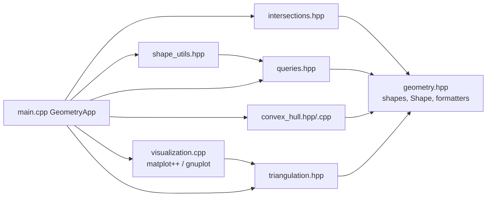

# cpp-middle-project5 — documentation hub

A two-dimensional geometry library in C++23: six shape types held in one `std::variant`, segment/circle intersections, point-to-shape distances, bounding-box queries, a Graham-scan convex hull and a Bowyer–Watson-style Delaunay triangulation. It is the sprint 5 project of the Yandex Practicum "Middle C++ developer" course (`README.md`). A console demo, `GeometryApp`, prints an analysis of random shapes and draws them with matplot++/gnuplot (`src/main.cpp`, `src/visualization.cpp`). Who uses the library besides the course is not stated in the repository.

The requirements reverse-engineered from the code are in [`SPEC.md`](../SPEC.md).

## Status

- Last commit touching the project's own code (`include/`, `src/`, `tests/*.cpp`, `CMakeLists.txt`): `b6d1720`, 2026-11-07 ("refactor(core): settle the sources under clang-tidy and clang-format"). The branch tip `9136b85` is a merge of tooling and docs commits.
- Tests: 18 GoogleTest cases in 6 files under `tests/`, plus a pytest check of the manual-test list (`CMakeLists.txt:46-80`). `tests/manual/tests.json` holds no manual tests (`"tests": []`).
- CI: five Gitea workflows under `.gitea/workflows/` from the shared template; `.gitea/workflows/test.yaml` runs on a `windows` runner.
- Evidently unfinished:
  - `class StackForGrahamScan {}` is an empty, unused class (`include/convex_hull.hpp:14`).
  - Course placeholders remain in the code: `/* ваш код здесь */` (`include/geometry.hpp:124,202,245`) and a comment about a `DummyClass` that no longer exists (`include/geometry.hpp:36-38`).
  - The comment above `ShapeToShapeDistanceVisitor` lists an "Any & Point" combination. The visitor does not implement it: `Point2D` is not a `Shape` alternative (`include/queries.hpp:102-132`).
  - `recipe.ps1 install` prints `nothing to install` (`recipe.ps1:93`). No gate builds the demo (`docs/install.md`).

## Layout

| Path | Contents |
| --- | --- |
| `include/geometry.hpp` | `Point2D`, `BoundingBox`, the shapes, `Shape` variant, `GeometryError`, epsilon helpers, `std::formatter` specialisations |
| `include/intersections.hpp` | `IntersectionVisitor`, `GetIntersectPoint` |
| `include/queries.hpp` | point/shape distance, shape/shape distance, bounding box, height, overlap |
| `include/convex_hull.hpp`, `src/convex_hull.cpp` | `CrossProduct`, `GrahamScan` (the only compiled library source) |
| `include/triangulation.hpp` | `DelaunayTriangle`, `Edge`, `DelaunayTriangulation` |
| `include/shape_utils.hpp` | `ShapeGenerator`, `FindAllCollisions`, `FindHighestShape` |
| `include/visualization.hpp`, `src/visualization.cpp` | matplot++ drawing of shapes and triangles (demo only) |
| `src/main.cpp` | `GeometryApp` console demo |
| `tests/*.cpp` | GoogleTest suites; `tests/main.cpp` is the gtest entry point |
| `tests/manual/` | manual-test list (`tests.json`), its page and local server (`index.html`, `serve.py`) |
| `tests/test_manual_list.py` | pytest check of the format of `tests/manual/tests.json` |
| `CMakeLists.txt` | targets `geometry_core`, `GeometryApp`, `GeometryApp_tests` |
| `docs/install.md`, `docs/manual.md` | author's install guide and manual |
| `conanfile.py`, `CMakePresets.json`, `scripts/build_windows.ps1`, `.devcontainer/`, `.vscode/` | earlier course and GitHub build routes; no gate runs them (`docs/install.md`) |

## Architecture

All geometry is header-only, apart from `src/convex_hull.cpp`, which builds as the static library `geometry_core` (`CMakeLists.txt:23-25`). Shapes are value types. Operations are `std::visit` visitors over `Shape = std::variant<Line, Triangle, Rectangle, RegularPolygon, Circle, Polygon>` (`include/geometry.hpp:39`). Fallible operations return `GeometryResult<T> = std::expected<T, GeometryError>` (`include/geometry.hpp:33-34`).



External dependencies: GoogleTest v1.13.0 for tests (`CMakeLists.txt:51-56`). The demo also uses matplot++ from its `master` branch via CPM.cmake (`CMakeLists.txt:28-40`), and gnuplot at runtime (`docs/install.md`).

## Build and run

Prerequisites (`docs/install.md`, `CMakeLists.txt:1-4`): mingw g++ 13 or newer, CMake 3.28 or newer, Ninja, LLVM (`clang-tidy`, `clang-format`), C++23. The CTest entry `manual_list` also needs Python with pytest (`CMakeLists.txt:75-79`). `recipe.ps1:51-54` adds `C:\ProgramData\mingw64\mingw64\bin` and `C:\Program Files\LLVM\bin` to PATH if they exist.

| Command | Effect | Source |
| --- | --- | --- |
| `.\recipe.ps1 build` | configure with Ninja, g++, Release, `-DGEOMETRY_APP_DEMO=OFF`, and build into `build\` | `recipe.ps1:56-62,89-92` |
| `.\recipe.ps1 test` | build, `ctest`, `clang-tidy`, `clang-format -i`, lock/exception word search | `recipe.ps1:126-145` |
| `.\recipe.ps1 run [gtest flags]` | build and run `build\GeometryApp_tests.exe` with the given arguments | `recipe.ps1:101-106` |
| `cmake -S . -B build-demo -G Ninja -DCMAKE_BUILD_TYPE=Release -DBUILD_TESTING=OFF` then `cmake --build build-demo` | build the `GeometryApp` demo (needs g++ 14+, gnuplot on PATH) | `docs/install.md` |

The first configure with tests downloads the GoogleTest archive, pinned by SHA256 (`CMakeLists.txt:51-56`). To use it as a library, put `include` on the include path and compile `src/convex_hull.cpp` (`docs/install.md`).

## Configuration

| Name | Kind | Meaning | Default | Source |
| --- | --- | --- | --- | --- |
| `GEOMETRY_APP_DEMO` | CMake option | build `GeometryApp` and fetch matplot++ | `ON` (recipe passes `OFF`) | `CMakeLists.txt:12` |
| `BUILD_TESTING` | CMake option | build `GeometryApp_tests` and register CTest tests | `ON` | `CMakeLists.txt:13` |
| `GEOMETRY_EPSILON` | preprocessor macro | tolerance of `is_zero`/`are_equal`/`is_less`/`is_greater` | `1e-10` | `include/geometry.hpp:42-46` |
| `LAB_SHARE` | env var | target root for `recipe.ps1 publish` | unset → publish fails | `recipe.ps1:109` |
| `.claude/.env` | file (gitignored) | `KEY=value` lines loaded into the environment by `recipe.ps1` if not already set | absent | `recipe.ps1:41-49`, `.gitignore:24` |

The library reads no runtime configuration. The demo's parameters are hard-coded in `src/main.cpp:92-93,104,125`: coordinates −50..50, sizes 5..25, 15 shapes, query point (10, 10).

## Usage

Library (from `docs/manual.md`):

```cpp
#include "convex_hull.hpp"
#include "queries.hpp"
using namespace geometry;

Shape circle = Circle{{10, 0}, 5};
double distance = queries::DistanceToPoint(circle, Point2D{4, 0});

std::vector<Point2D> points = {{0, 0}, {4, 0}, {4, 4}, {0, 4}, {2, 2}};
auto hull = convex_hull::GrahamScan(points);
if (!hull) { /* hull.error() is a GeometryError */ }
```

Every shape and `Shape` prints through `std::format("{}", shape)`. `std::vector<Point2D>` accepts `{}` or `{:new_line}` (`include/geometry.hpp:462-503`).

Tests (`docs/manual.md`): `.\recipe.ps1 run --gtest_list_tests`, `.\recipe.ps1 run --gtest_filter=QueriesTest.*`.

## Testing

`.\recipe.ps1 test` runs CTest with `--no-tests=error` (`recipe.ps1:132`). CTest holds two tests (`CMakeLists.txt:73-79`):

- `geometry_tests` — the gtest binary. It covers `Point2D` arithmetic, `Line`/`Rectangle`/`Circle`/`Polygon` properties (`tests/geometry_test.cpp`), the three supported intersection pairs plus the unsupported-pair throw (`tests/intersections_test.cpp`), point distance, bounding box, height and overlap (`tests/queries_test.cpp`), the Graham scan on a square and with too few points (`tests/convex_hull_test.cpp`), collisions and the highest shape (`tests/shape_utils_test.cpp`), and a 4-point Delaunay case (`tests/triangulation_test.cpp`).
- `manual_list` — `python -m pytest tests/test_manual_list.py`, which checks the shape of `tests/manual/tests.json`.

No test covers: `Triangle`/`RegularPolygon` members, `DistanceBetweenShapes`, `Lines()` outline generation, the formatters, `ShapeGenerator`, or `visualization`.

## Known limitations and problems

Each item comes from reading the code. None was confirmed by running it.

- `GetIntersectPoint(circle, line)` throws `std::logic_error`. Only the `(Line, Circle)` order has an overload; the reversed order reaches the generic overload (`include/intersections.hpp:35,98-100`).
- Parallel or collinear segments, overlapping ones included, return no intersection (`include/intersections.hpp:23-25`). When two points exist, `GetIntersectPoint` returns only the first (`include/intersections.hpp:113-115`).
- `DistanceBetweenShapes(line, line)` takes the minimum of the four endpoint-to-segment distances. Crossing segments therefore get a non-zero distance (inference from `include/queries.hpp:121-129`). The circle/circle branch uses the signed `radius`, while the other code paths use `std::abs(radius)` (`include/queries.hpp:115-119`).
- `Polygon::Center()` returns `(0, 0)` when the bounding box has zero width or height, with no signal to the caller (`include/geometry.hpp:433`, `136-153`).
- `FindAllCollisions` and `FindHighestShape` are non-`inline` functions defined in a header (`include/shape_utils.hpp:68,80`). Inference: including `shape_utils.hpp` in two translation units of one program would violate the one-definition rule.
- `GeometryError` values `Unsupported`, `NoIntersection` and `DegenrateCase` (sic) are never returned (`include/geometry.hpp:25-31`).
- `CMakePresets.json` points at a Conan toolchain and sets C++26 for Linux. `CMakeLists.txt` uses FetchContent instead. These presets are not exercised by any gate (`docs/install.md`).
- matplot++ and CPM.cmake are fetched from moving branches (`master`, `origin/master`), so demo builds are not reproducible (`CMakeLists.txt:32,38`).

## Repository tooling

The project follows [repo-quality-template](https://github.com/IGORSVOLOHOVS/repo-quality-template), lab requirements revision 4.0.0, with listed exceptions R-02, R-09, R-12, R-13, R-14, R-17, R-37, R-41, R-42 (`README.md`). Project-specific settings in `recipe.ps1`:

- `$Name = 'cpp-middle-project5'`, `$Code = 'cmp5'`, `$Version = '1.0.0'`, `$Needs = @()`, `$Tools = @()`.
- No `$App`: the demo is taken as a library on purpose (`recipe.ps1:18`). `$Provides = @('include', 'src')`.
- Verbs: `build`, `test` and `run` do real work as described above. `run` runs the test binary, not the demo. `publish` copies `include` and `src` to `$env:LAB_SHARE\needs\cpp-middle-project5\v1.0.0`. `clean` removes `dist`, `build`, `out`. `info` prints the variables. `install`/`uninstall` do nothing.
- Deviation: `test` allows exactly 4 `throw|try|catch` lines across `include/geometry.hpp`, `include/intersections.hpp` and `src/main.cpp` (`$ThrowsOnPurpose`, `$ThrowLinesOnPurpose`, `recipe.ps1:34-35`). It forbids them, and lock primitives, everywhere else in `include` and `src`.
- Deviation: `.claude/.env` is gitignored and never committed, a reversal of R-02 (`CLAUDE.md` rule 4, `.gitignore:24`).
- `clang-tidy` runs over `src/convex_hull.cpp` and `tests/*.cpp` with warnings as errors (`recipe.ps1:135`, `.clang-tidy`).

## Related documents

- [`../README.md`](../README.md) — project overview
- [`../SPEC.md`](../SPEC.md) — requirements specification
- [`install.md`](install.md) — install and demo build
- [`manual.md`](manual.md) — library and test usage
- [`../CLAUDE.md`](../CLAUDE.md) — repository rules
- [`../CONTRIBUTING.md`](../CONTRIBUTING.md), [`../LICENSE`](../LICENSE)

## About this document

Written 2026-11-18 from commit `9136b85`. Checks run: `git ls-files`, `git log`, `git check-ignore -v .claude/.env`, and reading the sources, tests, CMake and recipe files. Not run: any build, `recipe.ps1` verb, `ctest` or the demo. Building needs a network download of GoogleTest, which this pass did not allow. So whether the tests pass, and the "Known limitations" items, have not been checked at runtime.
